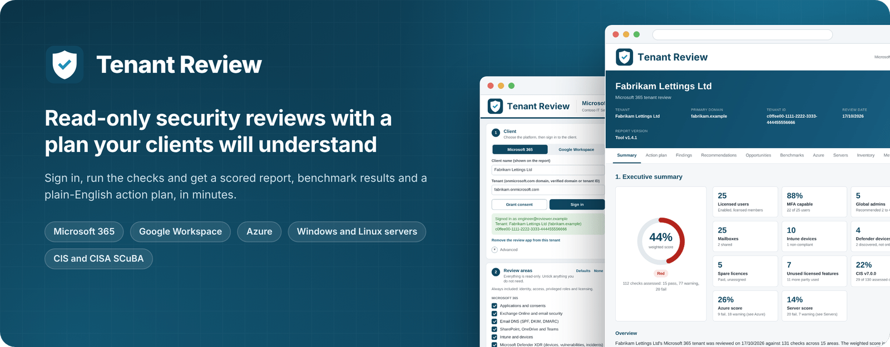

# Tools

Practical tools for IT consultants and managed service providers.

<table>
  <tr>
    <td width="96" align="center" valign="top">
      
    </td>
    <td valign="top">
      <h3><a href="tenant-review/">Tenant Review</a></h3>
      Read-only security and configuration reviews of Microsoft 365, Google Workspace, Azure and servers. Scores the client against the CIS and CISA SCuBA benchmarks and produces an HTML report, PDFs and CSV files, led by a plain-English action plan the client can follow.
        
      <a href="tenant-review/docs/how-to.md">How-to guide</a> | <a href="tenant-review/docs/reference.md">Reference</a> | <a href="tenant-review/samples/">Sample reports</a>
    </td>
  </tr>
</table>

  

