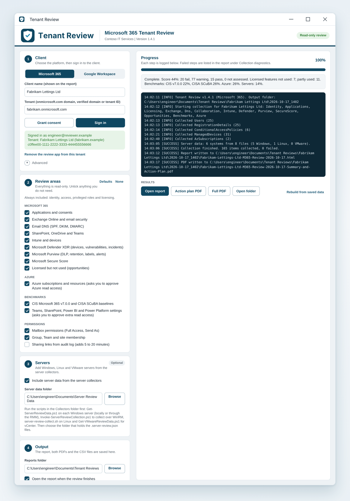
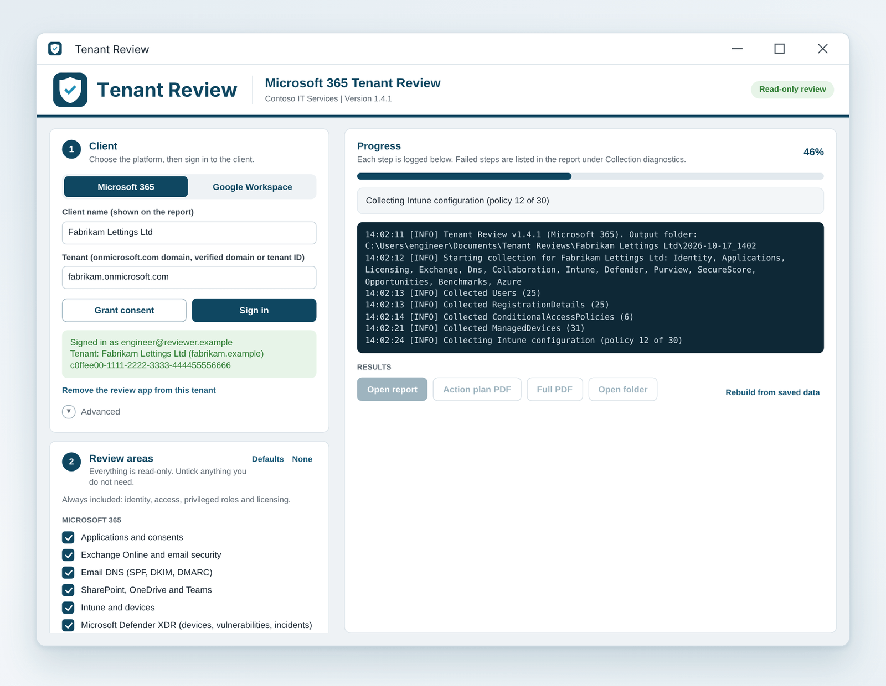
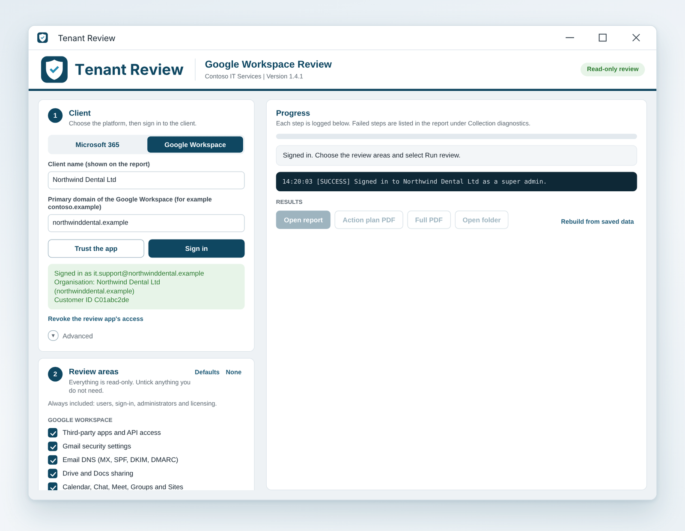
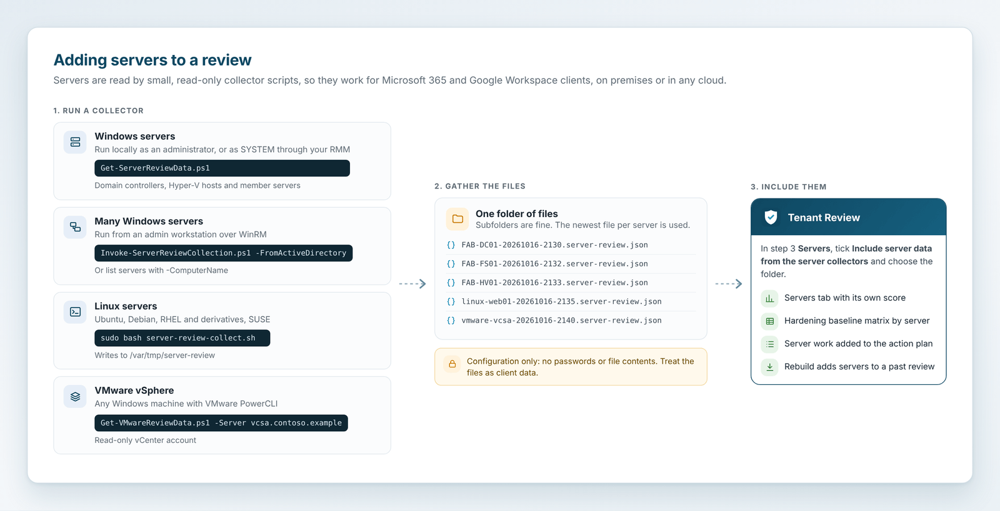
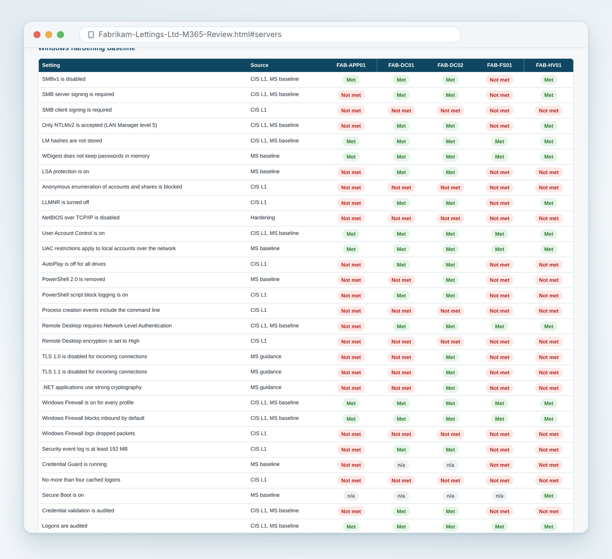
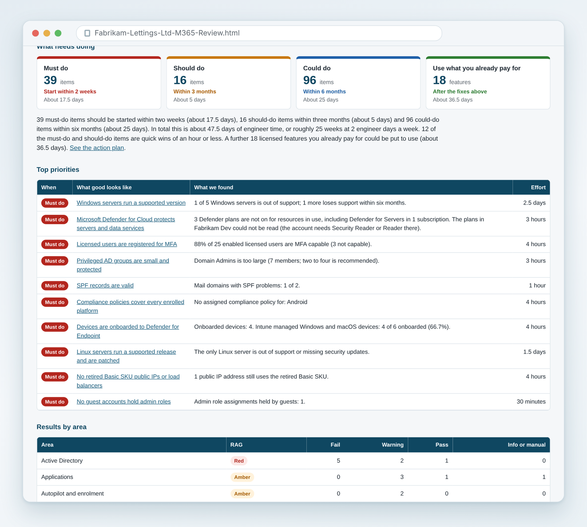
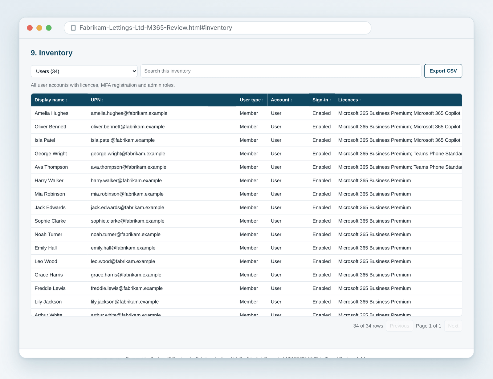
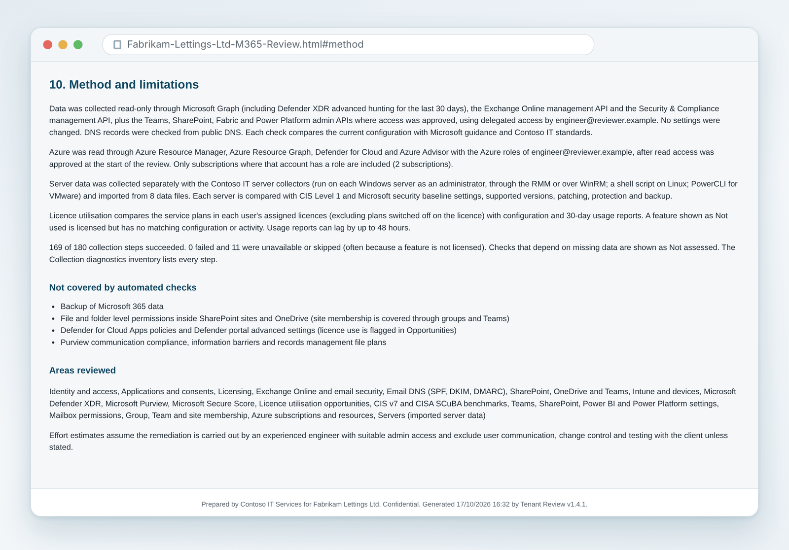

# How to use Tenant Review

This guide takes you from a fresh download to a finished client review. It covers the one-off setup, connecting each client, running Microsoft 365 and Google Workspace reviews, adding Azure and servers, reading the report and tidying up afterwards.

All screenshots use fictional organisations (Fabrikam Lettings Ltd, Northwind Dental Ltd and the IT provider Contoso IT Services) and `.example` domains.

## Contents

1. [Before you start](#1-before-you-start)
2. [Download the tool](#2-download-the-tool)
3. [One-off setup for Microsoft 365](#3-one-off-setup-for-microsoft-365)
4. [One-off setup for Google Workspace](#4-one-off-setup-for-google-workspace)
5. [Add your branding and settings](#5-add-your-branding-and-settings)
6. [The review at a glance](#6-the-review-at-a-glance)
7. [Run a Microsoft 365 review](#7-run-a-microsoft-365-review)
8. [Run a Google Workspace review](#8-run-a-google-workspace-review)
9. [Include Azure](#9-include-azure)
10. [Include servers](#10-include-servers)
11. [Read the report](#11-read-the-report)
12. [Share the results with the client](#12-share-the-results-with-the-client)
13. [Rebuild a report without signing in again](#13-rebuild-a-report-without-signing-in-again)
14. [Tidy up after the review](#14-tidy-up-after-the-review)
15. [Troubleshooting](#15-troubleshooting)
16. [Looking after client data](#16-looking-after-client-data)

## 1. Before you start

You need:

| Item | Detail |
| --- | --- |
| A Windows PC | Windows 10 or 11 with Windows PowerShell 5.1 (built in) or PowerShell 7. No PowerShell modules are needed. |
| Microsoft Edge or Google Chrome | Used for sign-in and to create the PDFs in the background. |
| Microsoft 365 clients | An admin account in the client tenant with **Global Administrator**, or a partner account with a GDAP relationship that includes **Global Reader**. Global Administrator is simplest, because it covers consent, sign-in and every read the tool needs. |
| Google Workspace clients | A **super admin** account in the client's Google Workspace. Delegated admin roles cannot read the Policy API or several reports. |
| Your own tenant (once) | A Global Administrator or Application Administrator to create the review app registration. |
| A Google Cloud project (once) | Only if you review Google Workspace clients. |

If you work through GDAP, these extra roles fill gaps that Global Reader leaves:

| Role | Adds |
| --- | --- |
| Cloud Application Administrator | Lets engineers grant consent themselves |
| Security Reader | Defender advanced hunting and incidents |
| Reports Reader | Usage reports, if Global Reader does not return them |
| Compliance Administrator | DLP policies and the optional sharing audit |
| Teams, SharePoint, Fabric and Power Platform Administrator | The service settings used by the benchmarks |

Anything the account cannot read is reported as **Not assessed** with the reason. The rest of the review still runs.

## 2. Download the tool

1. On the repository page, select **Code**, then **Download ZIP**, or clone the repository with Git.
2. Extract the `tenant-review` folder somewhere your engineers can reach, for example a shared tools library.
3. Leave the folder structure as it is. The launcher expects the `Module`, `Assets` and `Collectors` folders next to it.

Windows marks downloaded files as coming from the internet. `Start-TenantReview.cmd` unblocks the files in the folder each time it starts, so you do not need to change the execution policy.

## 3. One-off setup for Microsoft 365

This creates one app registration in **your own** tenant. Every engineer uses it to review every client. It is multi-tenant, delegated and read-only, and it has no secret or certificate.

1. Open PowerShell in the `tenant-review` folder.
2. Run the setup script:

   ```powershell
   .\New-TenantReviewApp.ps1
   ```

3. Sign in to your own tenant as a Global Administrator or Application Administrator.
4. The script creates an app called **Tenant Review** with delegated, read-only permissions to Microsoft Graph, Exchange Online and the Security & Compliance API, then writes its client ID into `config.json`.
5. Share the folder, including `config.json`, with the engineers who will run reviews.

The script also prints an admin consent link you can send to a client who prefers to approve the app themselves.

> **Tip:** You can verify your organisation as the publisher of the app with your Microsoft Partner ID. The consent screen then shows a verified publisher, which reassures clients.

When a new version adds permissions, run `.\New-TenantReviewApp.ps1 -UpdateExisting` once, then use **Grant consent** again for each client before their next review. Until then, only the controls that need the new permissions show Not assessed.

To create the app by hand in the Entra admin centre instead, follow [Manual app registration](reference.md#manual-app-registration) in the reference.

## 4. One-off setup for Google Workspace

Skip this section if you only review Microsoft 365. It is done once by your organisation, not once per client.

1. In the [Google Cloud console](https://console.cloud.google.com/), create a project, for example **tenant-review**.
2. Enable these five APIs (**APIs and services**, **Library**): Admin SDK API, Cloud Identity API, Enterprise License Manager API, Groups Settings API and Google Workspace Alert Center API. With the gcloud CLI:

   ```
   gcloud services enable admin.googleapis.com cloudidentity.googleapis.com licensing.googleapis.com groupssettings.googleapis.com alertcenter.googleapis.com --project tenant-review
   ```

3. Open **Google Auth platform**:
   - **Branding**: set the app name to **Tenant Review**, add your support email, logo and your website domain as an authorised domain.
   - **Audience**: choose **External** so client super admins can sign in, then select **Publish app**. In Testing, only listed test users can sign in and sign-ins expire after seven days.
   - **Clients**: select **Create client**, choose **Desktop app** and name it **Tenant Review**. Copy the client ID and the client secret.
4. Put them into `config.json` as `GoogleClientId` and `GoogleClientSecret`.

Google does not treat a Desktop app secret as confidential, and the tool also uses PKCE. The secret gives no access on its own: every sign-in still needs a client super admin to approve it, and the client must trust the app first.

If you review more than a handful of Google clients, submit the app for verification under **Verification centre**. Until then, the consent screen shows an unverified app warning and Google caps unverified apps at 100 users in total. No restricted scopes are used, so no security assessment is needed.

## 5. Add your branding and settings

Open `config.json` in a text editor and set at least these values:

| Setting | What to put |
| --- | --- |
| `CompanyName` | Your organisation's name. It appears in the app header and on every report. |
| `CompanyShortName` | A short form of the name, used in shorter labels. |
| `LogoPath` | Optional. Your logo as SVG, PNG or JPG. Relative paths are from the tool folder. Leave it empty to use the Tenant Review logo. |
| `DayRate` | Optional. Your day rate, to show an indicative cost for each group in the action plan. `0` hides costs. |
| `PlanDaysPerWeek` | Engineer days a week assumed for the action plan timeline. The default is `2`. |

The full list of settings is in the [reference](reference.md#settings-configjson).

## 6. The review at a glance


*Figure 1. The six steps of a review. Steps 1 and 2 are done once.*


*Figure 2. The tool signs in, reads configuration through the official APIs and works out every result on the engineer's PC.*

## 7. Run a Microsoft 365 review

### 7.1 Start the app

Double-click `Start-TenantReview.cmd`. The window opens with **Microsoft 365** selected. Select **Create desktop shortcut** under **Advanced** if you want a desktop icon that starts the tool without a console window.


*Figure 3. The app after a completed review. Step 1 is on the left, with progress, the live log and the results on the right.*

### 7.2 Enter the client

1. Leave **Microsoft 365** selected.
2. Enter the **Client name**. It appears on the report and names the output folder.
3. Enter the **Tenant**: the onmicrosoft.com domain, a verified domain or the tenant ID.

### 7.3 Grant consent (first time for each client only)

1. Select **Grant consent**.
2. Sign in with a Global Administrator of the client, or a GDAP account with Cloud Application Administrator.
3. Approve the permissions, then wait about a minute before signing in.

Consent is needed once per client, and again only after the app's permissions change.

### 7.4 Sign in

Select **Sign in** and complete sign-in and MFA in the browser with the account that will run the review. The status box turns green and shows the account, tenant name, primary domain and tenant ID.

If the browser picks up a session for a different client, select **Copy sign-in link** and paste it into an InPrivate window.

### 7.5 Choose the review areas

Identity, access, privileged roles and licensing are always included. Tick the other areas you want, or use **Defaults** and **None** to set them quickly.

| Area | Notes |
| --- | --- |
| Applications and consents | High-risk permissions, consents, expiring secrets and certificates |
| Exchange Online and email security | Mail flow, forwarding, anti-phishing, Safe Links and more |
| Email DNS (SPF, DKIM, DMARC) | Read from public DNS |
| SharePoint, OneDrive and Teams | Sharing, sync and guest settings |
| Intune and devices | Compliance, encryption, enrolment and Intune set-up |
| Microsoft Defender XDR | Devices, vulnerabilities and incidents |
| Microsoft Purview | DLP, retention, labels and alerts |
| Microsoft Secure Score | Every improvement action with its gap |
| Mailbox permissions | Full Access and Send As; adds about a second per mailbox |
| Group, Team and site membership | Owners and members |
| Sharing links from audit log | Optional; adds 5 to 20 minutes |
| Licensed but not used | Licence utilisation opportunities |
| CIS Microsoft 365 v7.0.0 and CISA SCuBA baselines | The Benchmarks tab |
| Teams, SharePoint, Power BI and Power Platform settings | Asks once for extra read access |
| Azure subscriptions and resources | See [Include Azure](#9-include-azure) |



*Figure 4. The whole window, showing every review area, the Servers step and the Output step.*

### 7.6 Run the review

1. In step 4 **Output**, check the **Reports folder**. The default is `Documents\Tenant Reviews`.
2. Select **Run review**.
3. If you ticked the service settings or Azure, the browser opens once to approve read access the first time you review that client with that account. Approve it and the review carries on. **Copy sign-in link** is shown while it waits, in case the wrong browser profile opened.

A typical small business tenant takes 2 to 5 minutes. The progress bar and live log show each step as it runs.



*Figure 5. A review in progress. Every collection step is logged with its result.*

### 7.7 Open the results

When the review finishes, use the buttons under **Results**:

| Button | Opens |
| --- | --- |
| Open report | The interactive HTML report |
| Action plan PDF | The short summary and action plan for the client |
| Full PDF | The complete report as an A4 PDF |
| Open folder | The output folder with the CSV files, raw data and log |

## 8. Run a Google Workspace review

### 8.1 Trust the app (first time for each client only)

1. Select **Google Workspace** at the top of the window. The review areas, sign-in and tidy-up buttons switch to their Google versions.
2. Select **Trust the app**. The tool copies the client ID to the clipboard, shows the steps and opens the Admin console.
3. Sign in to admin.google.com as a super admin of the client.
4. Go to **Security**, **Access and data control**, **API controls**, **Manage third-party app access**.
5. Select **Configure new app**, search for the client ID and select **Tenant Review**.
6. Apply it to the whole organisation and set access to **Trusted**.

Until this is done, a client that blocks unconfigured apps returns `admin_policy_enforced`, and the tool tells you the app must be trusted.

### 8.2 Sign in and run

1. Enter the client name and the primary domain of their Google Workspace.
2. Select **Sign in** and sign in as a super admin of the client. On the consent screen, tick every permission.
3. The status box shows the organisation name, primary domain and customer ID. If a permission was not ticked, the log lists the areas that will show Not assessed. Sign in again to include them.
4. Choose the review areas and select **Run review**. A typical small business takes 1 to 3 minutes.



*Figure 6. Google Workspace mode, signed in to a client and ready to run.*

Settings are read for the whole organisation and for every organisational unit or group that overrides it, so a finding can say, for example, that forwarding is off for the organisation but allowed in one organisational unit.


*Figure 7. The executive summary of a Google Workspace review.*

## 9. Include Azure

Azure is available for Microsoft 365 clients.

1. Tick **Azure subscriptions and resources** in the review areas.
2. When the review starts, approve read access to Azure Resource Manager in the browser. This is asked once per client and account.

The account needs an Azure role on each subscription, or on a management group above them. **Reader** covers most checks and **Security Reader** adds the Defender for Cloud detail. Global Administrator on its own does not give access to subscriptions. For CSP subscriptions, your admin agents usually already hold a role through the partner relationship. Subscriptions billed elsewhere need a role in the client tenant or through Azure Lighthouse.

Subscriptions the account cannot see are not reviewed, and the report asks you to confirm with the client that none are missing.


*Figure 8. Azure has its own tab and its own score, separate from the Microsoft 365 score.*

## 10. Include servers

Servers are reviewed from files gathered by small, read-only collector scripts in the `Collectors` folder. This works for Microsoft 365 and Google Workspace clients alike, and for servers on premises or in any cloud.



*Figure 9. Run a collector, gather the files in one folder, then include the folder in the review.*

### 10.1 Run a collector

| Collector | Where it runs | How |
| --- | --- | --- |
| `Get-ServerReviewData.ps1` | Each Windows server, including domain controllers and Hyper-V hosts (Windows Server 2012 R2 or later) | Run as an administrator, or as SYSTEM through your RMM. Writes to `C:\ProgramData\TenantReview\ServerData` by default. Use `-OutputPath` for a share the computer account can write to. Takes 1 to 5 minutes, mostly the missing update search. `-SkipUpdateSearch` skips it. |
| `Invoke-ServerReviewCollection.ps1` | An admin workstation or management server | Runs the Windows collector over WinRM. Use `-ComputerName SRV01, SRV02`, or `-FromActiveDirectory` for every enabled server that signed in during the last 30 days. Optional `-Credential` and `-UseSSL`. Saves to `Documents\Server Review Data`. |
| `server-review-collect.sh` | Each Linux server (Ubuntu, Debian, RHEL and derivatives, SUSE) | `sudo bash server-review-collect.sh` writes to `/var/tmp/server-review`. Give a folder as the first argument, or `-` to print to the console. |
| `Get-VMwareReviewData.ps1` | Any Windows machine with VMware PowerCLI | `-Server vcsa.contoso.example` with a read-only vCenter account. Covers hosts, virtual machines, datastores and clusters. |

For example, to collect from every server in Active Directory:

```powershell
.\Collectors\Invoke-ServerReviewCollection.ps1 -FromActiveDirectory
```

Each collector writes one `.server-review.json` file per server. The files hold configuration only, with no passwords or file contents, but treat them as client data.

### 10.2 Include the files in the review

1. Copy all the files into one folder. Subfolders are fine.
2. In step 3 **Servers**, tick **Include server data from the server collectors** and choose the folder.
3. Run the review as normal. If a server appears more than once, the newest file is used.

You can also add servers after a review has run: tick the box, choose the folder and select **Rebuild from saved data**.


*Figure 10. The Servers tab, with its own score, the systems found and the findings by server.*



*Figure 11. The hardening baseline matrix shows each setting against each server.*

The **Server data coverage** finding lists every file found, which were used, and any sections that could not be read. Missing sections usually mean the collector did not run as an administrator.

## 11. Read the report

The HTML report opens in the browser. Use the tabs across the top to move between sections. Every table can be filtered and searched, and most have a CSV export.

### 11.1 Executive summary

The first tab gives the overall score, the RAG status of each area, the headline numbers and a plain-English overview.


*Figure 12. The executive summary, with the weighted score and key figures.*

Further down, **What needs doing** shows the action plan groups as cards with the top priorities across every area.



*Figure 13. What needs doing and the top priorities.*

### 11.2 Action plan

The action plan turns the findings into work the client can follow without reading the technical detail.

| Group | What goes in it | Suggested timescale |
| --- | --- | --- |
| Must do | High-severity failures (P1) | Start within 2 weeks |
| Should do | Medium-severity failures and high-severity warnings (P2) | Within 3 months |
| Could do | Other warnings and low-severity items (P3) | Within 6 months |
| Use what you already pay for | Licensed features not used or only partly used | After the fixes above |
| Things to confirm | Manual checks to go through with the client | At the review meeting |

Items are gathered into themes the client recognises, such as "Protect sign-ins and accounts" or "Stop others sending email as you". Each theme says why it matters, what staff will notice, what you need from the client and the engineer time. An indicative timeline shows how long each group takes at the `PlanDaysPerWeek` setting.


*Figure 14. The action plan, with the groups, the indicative timeline and the first themes.*

### 11.3 Findings

Every check with its status, severity, evidence, the affected items and how to fix it. Filter by area, status or severity. Each finding lists the benchmark controls it relates to.


*Figure 15. The Findings tab with its filters.*

### 11.4 Recommendations

The failed and warning findings as a prioritised list with effort in hours and days, ready to turn into a proposal.


*Figure 16. Prioritised recommendations with effort.*

### 11.5 Opportunities

Licensed features the client pays for but does not use, or only partly uses. Each one says what you would set up, the benefit to the client and an effort estimate.


*Figure 17. Licensed but not used.*

### 11.6 Benchmarks

Every CIS and CISA SCuBA control for the platform, assessed from the same data as the findings.

| Status | Meaning |
| --- | --- |
| Met | The setting meets the control |
| Not met | The setting does not meet the control. The evidence says what was found |
| Check manually | The setting has no API, or the control needs a judgement call |
| Not assessed | The data the control needs could not be read. The reason is shown |
| Not applicable | The control needs a licence the client does not have, or applies only to US federal agencies |

The score for each framework is the controls met divided by the controls met plus not met. A second figure shows the core score: Level 1 for CIS and SHALL controls for SCuBA.


*Figure 18. CIS and CISA SCuBA results, with filters by framework, level, section and status.*

### 11.7 Inventories

Searchable tables of everything collected: users, admin roles, Conditional Access, licences, domains and DNS, mailboxes, groups, devices, applications, policies, Azure resources and servers. The **Collection diagnostics** inventory lists every collection step with its HTTP status, so a failure can be diagnosed from the report alone.



*Figure 19. The inventories, each with search and CSV export.*

### 11.8 Method and limitations

What was reviewed, when, by whom, which areas were included, and what the tool cannot see. Point the client to this tab if they ask how the review was done.



*Figure 20. Method and limitations.*

## 12. Share the results with the client

Each review writes two PDFs next to the HTML report:

| File | Use it for |
| --- | --- |
| `<Client>-...-Summary-and-Action-Plan.pdf` | The client and their board. It holds only the executive summary and the action plan. |
| `<Client>-...-Review-<date>.pdf` | The full report as an A4 PDF. The inventories are left out because they can run to thousands of rows; they are in the HTML and CSV files. |


*Figure 21. Pages from the summary and action plan PDF.*

A good review meeting runs in this order:

1. Walk through the executive summary and the score.
2. Go through **Things to confirm** together, so the manual checks are settled.
3. Agree the **Must do** items and a start date.
4. Use **Use what you already pay for** to show value from licences the client already has.
5. Send the summary and action plan PDF afterwards.

`ActionPlan.csv` has one row per item for quoting or importing into your PSA.

## 13. Rebuild a report without signing in again

Every review saves `RawData.json`, which holds everything collected. **Rebuild from saved data** regenerates the report, PDFs and CSV files from it. Use it to:

- change settings such as `DayRate` or `CompanyName` and regenerate the report;
- add or refresh server data after the review;
- pick up check changes in a newer version of the tool.

Rebuilding does not read the tenant again, so it cannot pick up changes the client has made since the review, or Azure subscriptions that were not visible at the time.

## 14. Tidy up after the review

### Microsoft 365

Tick **Remove the review app from the client tenant when the review finishes** before you run the review. After the report is written, you sign in once more and approve the one-off permission to remove applications. The tool then deletes the review app's enterprise application, its consents (including the service permissions) and, where allowed, its entry in deleted items.

The same action is available at any time from **Remove the review app from this tenant** below the sign-in status. Use **Grant consent** again before the next review.

### Google Workspace

Tick **Revoke the review app's access when the review finishes**, or select **Revoke the review app's access** below the sign-in status. Google deletes the tokens issued for the review. If the client only trusted the app for this review, a super admin can also remove it from the API controls list.

### Servers

Delete the `.server-review.json` files from the servers and any shares once you have copied them to the client's folder.

## 15. Troubleshooting

| Symptom | Cause and fix |
| --- | --- |
| "has not been consented in this tenant" | Select **Grant consent** for that client. Consent is per client and only needed once, or again after the app's permissions change. |
| "has no access to the tenant" | The GDAP relationship has expired or your security group is not assigned to it. |
| "Blocked by a Conditional Access policy" | The client's Conditional Access blocks the sign-in. Check the client's sign-in log for the attempt. |
| Exchange checks show Not assessed | Exchange did not accept the token. Check the Collection diagnostics inventory for the exact error, and confirm Global Reader is in the GDAP relationship. |
| No PDF was created | The log says why. Usually Edge is not in the standard location. Set `PdfBrowserPath` in `config.json`, or open the HTML report and select **Save as PDF**. |
| Google: "blocks this app" (`admin_policy_enforced`) | The client has not trusted the review app. Use **Trust the app**, then wait a few minutes. |
| Google: HTTP 403 "insufficient authentication scopes" | A permission was not ticked on the consent screen. Sign in again and tick every permission. |
| Azure tab shows no subscriptions | The account has no Azure role on any subscription. Assign Reader and Security Reader, then run the review again. |
| Server data: 0 systems | The folder holds no `.server-review.json` files from the collectors. Check the Server data files inventory. |
| `Invoke-ServerReviewCollection.ps1` fails for a server | WinRM is not enabled or is blocked. Run `Enable-PSRemoting` on the server, use the FQDN so Kerberos works, or run the collector locally through your RMM. |

The [reference](reference.md#troubleshooting) has the full list.

## 16. Looking after client data

The tool is read-only, but its outputs describe the client's environment in detail.

- Store each output folder with the client's documentation, with the same care as any other client data.
- Do not commit review outputs, `RawData.json` or server files to a public repository.
- Tokens are held in memory only and are discarded when the window closes. Nothing is written to the client tenant, apart from removing the review app when you ask the tool to.
- The Google client secret in `config.json` gives no access on its own, but keep `config.json` in a private location for your organisation rather than a public fork.
